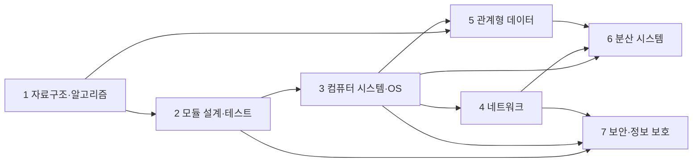

# CS 기초 커리큘럼 seed 설계 v0.1

초기 데이터는 커리큘럼 `개발자를 위한 CS 기초` 하나, 학습 단원 7개, 핵심 논문 레코드 7개, 실습 7개, 개념 Wiki 약 20개로 구성한다. 아래는 생성할 페이지와 학습 데이터의 설계이며, 현재 앱·DB에 seed를 넣거나 PDF를 다운로드한 상태는 아니다.

자료 제목·링크는 대학·저자·출판 기관의 공개 페이지를 확인했다. 학습 순서·실습·완료 기준은 이 서비스 목적에 맞춘 제안이다. 논문은 개념을 만든 이유를 읽는 자료로 사용하고, 기본 문법·자료구조·시스템 개념은 공개 교재의 지정 단원으로 보완한다.

## 1. 진입 조건과 전체 흐름

기본 진입 조건은 한 언어로 함수·조건문·반복문을 작성하고 간단한 프로그램을 터미널에서 실행할 수 있는 수준이다. 부족하면 선행 Wiki에서 함수/자료형, 집합·논리·그래프, CLI·파일 경로, Git commit, 간단한 테스트를 먼저 학습한다. 별도의 기초 프로그래밍 강좌나 온라인 IDE를 만들지는 않는다.

표시 순서는 아래 1~7이며 실제 선수관계는 edge로 따로 저장한다. OS 이후 네트워크와 DB는 병행할 수 있고, 보안은 네트워크까지 익힌 뒤 분산 시스템과 병행할 수 있다.

단원 기본 흐름은 `기초 Wiki → 공개 교재 지정 범위 → 논문 지정 구간 → 자기 설명 3문항 → 작은 실습 → 결과·회고 → 완료 체크`다. 논문 전체 완독을 모든 단원의 진입 조건으로 삼지 않는다. 학습 시간은 설정 가능한 예상치이며 정해진 주차에 강제로 맞추지 않는다.

## 2. 초기 단원

| 단원 | 기초·Wiki 주제 | 핵심 논문/읽기 범위 | 실습·완료 기준 |
| --- | --- | --- | --- |
| 1. 자료구조·알고리즘 | 집합·그래프·Big-O, 배열·해시·힙, 탐색·최단 경로 | Dijkstra, *A Note on Two Problems in Connexion with Graphs* (1959). 문제와 알고리즘을 읽기 | 가중 그래프 최단 경로 CLI. 정상·도달 불가·동일 비용 사례 테스트, 음수 간선 제약과 복잡도 설명 |
| 2. 모듈 설계·테스트 | 추상화·정보 은닉, 인터페이스·불변식, 단위/동작 테스트 | Parnas, *On the Criteria To Be Used in Decomposing Systems into Modules* (1972). 두 분해 방법과 판단 기준 | 작은 논문 목록 CLI의 메모리/JSON 저장소를 교체. 호출부 수정 없이 같은 동작 테스트 통과, 숨긴 결정 2개 설명 |
| 3. 컴퓨터 시스템·OS | CPU·메모리 계층, 주소 공간, process·file·pipe, thread 입문 | Ritchie & Thompson, *The UNIX Time-Sharing System* (1974). 파일·프로세스·shell 중심 | 두 자식 process를 pipe로 연결하는 명령 실행기. 시작·대기·종료와 실행 실패 처리, FD 흐름 그림 |
| 4. 네트워크·신뢰성 | 계층·IP·TCP, socket·요청/응답, 전달 성공과 업무 성공 | Saltzer, Reed & Clark, *End-to-End Arguments in System Design* (1984). 파일 전송 사례와 설계 논증 | localhost 파일 전송 + 저장 완료 응답 + checksum. 저장 실패를 성공으로 표시하지 않고 성공 보장의 위치 설명 |
| 5. 관계형 데이터·트랜잭션 | 관계 모델·키·제약, 정규화·JOIN, index·transaction | Codd, *A Relational Model of Data for Large Shared Data Banks* (1970). 데이터 독립성과 관계 모델 | 논문·저자·컬렉션 DB. 다대다 조회·중복 제약·중간 실패 rollback, 단일 JSON과의 선택 이유 |
| 6. 분산 시스템 기초 | 지연·부분 실패, happened-before, Lamport clock | Lamport, *Time, Clocks, and the Ordering of Events in a Distributed System* (1978). 사건 순서·논리 시계 | 한 로컬 프로그램에서 3개 node 모사. `a → b`이면 `L(a) < L(b)` 검증, 역명제 반례와 메시지 trace 기록 |
| 7. 보안·정보 보호 | 최소 권한·기본 거부, 인증/인가, 비밀정보와 데이터 흐름 | Saltzer & Schroeder, *The Protection of Information in Computer Systems* (1975). Section I 중심 | 가상 로컬 설정 API의 공개/비밀 필터와 읽기 권한. 비허용 요청 거절·비밀값 비노출 테스트, 데이터 흐름·위협 노트 |

단원 3의 컴퓨터 구조 기초는 CPU가 명령을 실행하고 주소 공간과 cache/메모리를 통해 데이터를 읽는 흐름까지 포함한다. 디지털 회로·ISA 구현 전체를 필수로 확장하지 않는다. 단원 6도 합의 알고리즘 전체 구현이나 실제 클러스터 운영까지 확장하지 않는다.

실습 언어는 사용자가 선택한 익숙한 언어를 우선한다. OS process/pipe 실습은 Python·C 등의 표준 API 예시를 제공할 수 있다. 모든 단원에 재현 방법, 최소 테스트, Git commit 또는 결과 파일 경로를 공통 산출물로 둔다. 제출 경로는 학습 기록이며 임의 코드 실행 명령이 아니다.

## 3. 검증한 원문·선행 자료

| 단원 | 논문 링크 | 선행 자료 |
| --- | --- | --- |
| 1 | [Dijkstra 논문 및 원문 링크 — South Carolina 대학](https://jmvidal.cse.sc.edu/lib/dijkstra59a.html) | [MIT 6.006 Introduction to Algorithms](https://ocw.mit.edu/courses/6-006-introduction-to-algorithms-fall-2011/): 복잡도·자료구조·그래프 관련 노트 |
| 2 | [Parnas 논문 — ACM DOI](https://doi.org/10.1145/361598.361623) | [MIT 6.031 Software Construction](https://web.mit.edu/6.031/www/sp21/): Testing, Specifications, ADT, Interfaces |
| 3 | [UNIX 논문 — CMU 원문 PDF](https://www.cs.cmu.edu/~15712/papers/ritchie74.pdf) | [Operating Systems: Three Easy Pieces](https://pages.cs.wisc.edu/~remzi/OSTEP/): Processes, Process API, Address Spaces, Files and Directories; Threads 보충 |
| 4 | [End-to-End 논문 — MIT 저자 원문](https://web.mit.edu/Saltzer/www/publications/endtoend/endtoend.pdf) | [An Introduction to Computer Networks](https://intronetworks.cs.luc.edu/): 계층·IP·TCP·socket 관련 단원 |
| 5 | [Codd 논문 — IBM Research](https://research.ibm.com/publications/a-relational-model-of-data-for-large-shared-data-banks) | [CMU 15-445/645](https://15445.courses.cs.cmu.edu/fall2025/): 관계 모델·SQL·index·transaction 공개 자료 |
| 6 | [Lamport 논문 — 저자 원문](https://lamport.azurewebsites.net/pubs/time-clocks.pdf) | [OSTEP](https://pages.cs.wisc.edu/~remzi/OSTEP/): Distributed Systems. [MIT 6.5840](https://pdos.csail.mit.edu/6.824/)은 선택 심화 링크 |
| 7 | [Protection 논문 — MIT 저자 원문 HTML](https://www.mit.edu/~Saltzer/publications/protection/index.html) | [Berkeley CS 161 교재](https://textbook.cs161.org/): Security Principles, Passwords, Web Security 기초 |

DOI/출판사 레코드가 있다고 무료 PDF 접근이 보장되지는 않는다. 초기 seed에는 title/authors/year/source URL/읽기 범위를 저장한다. 사용자가 가진 PDF를 mount에서 연결하거나, 접근 가능한 공개 원문을 사용자가 명시적으로 가져올 때 로컬 paper ID를 연결한다. 링크만 있는 자료는 `원문 미연결`을 표시하고 가짜 PDF 페이지 anchor를 만들지 않는다.

초기 제공은 검증한 자료 목록으로 충분하다. 후속 메타데이터 조회는 DOI/arXiv 등 명시한 식별자의 조회부터 추가할 수 있다. 추천을 이유로 대규모 크롤링이나 PDF 자동 일괄 다운로드를 시작하지 않는다. 외부 자료 링크 열기는 외부 사이트로 이동하는 동작임을 표시한다.

## 4. Wiki 페이지 템플릿과 초기 목록

Wiki 한 페이지는 `한 문장 정의 / 필요한 선수 개념 / 작은 예시 / 흔한 오해 / 연결 논문·근거 / 관련 단원 / 자기 설명 질문`을 갖는다. 일반 Markdown으로 작성하며 링크는 wiki/paper/resource ID를 통해 관리한다. source가 없는 AI 문장은 초안으로 표시한다.

| 묶음 | 초기 Wiki 페이지 |
| --- | --- |
| 학습 진입 | CLI·Git·재현 가능한 실행, 테스트와 결과 기록 |
| 알고리즘 | Big-O와 자료구조 선택, 그래프·최단 경로, 불변식 |
| 설계 | 추상화·정보 은닉, 인터페이스·계약, 테스트 경계 |
| 시스템 | CPU·메모리 계층·주소 공간, 프로세스와 스레드, 파일 디스크립터·파이프 |
| 네트워크 | 계층·IP·TCP, 종단 간 신뢰성 |
| 데이터 | 관계·키·정규화, SQL·JOIN·index, 트랜잭션 |
| 분산 | 부분 실패, 인과 관계·논리 시계 |
| 보안 | 최소 권한·기본 거부, 인증·인가·비밀정보 |

Wiki의 근거는 가용한 경우 `{paperId, paperRevisionId, segmentId, pageNumber}`를 저장한다. 링크뿐인 외부 자료는 URL과 절/장 제목으로 연결한다. 사용자가 확정한 본문과 AI가 제안한 변경은 별도 revision으로 보존한다. 생성한 AI 초안이 사용자 글을 조용히 덮어쓰지 않는다.

## 5. 자기 설명·실습·완료

단원별 자기 설명은 다음 세 종류를 기본으로 한다. 문항 내용은 데이터로 수정 가능하다.

1. 개념: 핵심 개념을 자신의 말로 설명하고 작은 예시 하나를 든다.
2. 근거: 논문에서 설계 판단을 뒷받침하는 구간을 가리킨다.
3. 적용: 실습에서 그 판단이 달라지는 조건 또는 실패 사례를 설명한다.

예를 들어 네트워크 단원은 “TCP 전송이 끝났는데 파일 저장이 실패할 수 있는가?”, “어떤 계층에서 성공을 확인해야 하는가?”, “송신자가 성공을 알기 전에 연결이 끊기면 어떻게 표현할 것인가?”를 묻는다. 질문·모범 기준은 강의 자료의 장문 복사 대신 서비스용으로 작성한다.

실습 제출은 `실행 환경·방법`, `코드 경로 또는 commit`, `정상/실패 결과`, `짧은 회고`를 기록한다. 환경 연결 없이도 텍스트 결과를 남길 수 있다. 파일 증빙을 실제 열람하는 기능이 추가되면 승인된 library와 별도 artifact root 범위로 제한한다.

완료 조건은 필수 읽기 확인, 자기 설명 답안 작성, 실습 증빙·최소 확인 항목 충족, 사용자 완료 체크다. 실제 의미 이해를 자동으로 증명한다고 하지 않는다. AI는 답안 피드백을 제공할 수 있지만 자동 합격/불합격으로 학습 기록을 확정하지 않는다.

진도는 `not_started / in_progress / completed`로 시작하고 별도 `next_review_at`으로 복습을 예약한다. 커리큘럼 내용을 바꿔도 이전 완료와 제출은 해당 lesson revision에 남긴다. 각 revision은 질문·block·완료 기준·당시 자료와 읽기 범위의 immutable snapshot을 보존하고, Wiki/PDF 연결도 당시 revision ID를 고정한다. 단원 archive는 기록을 지우지 않는다.

## 6. Seed와 유지보수 계약

기본 자료는 안정적인 `seedKey`와 `seedVersion`으로 식별한다. 최초 bootstrap과 명시적 seed 적용에서만 삽입하고, 앱 시작마다 사용자가 지운 단원을 되살리거나 수정한 Wiki를 덮어쓰지 않는다.

seed 업데이트는 새 버전 차이를 제안한다. 사용자가 수정한 데이터에는 자동 overwrite를 하지 않고 현재 유지/템플릿 갱신 선택을 제공한다. link 검증 시각과 공개/메타데이터 전용 여부를 resource metadata에 보관한다. 링크가 끊겨도 로컬 PDF와 학습 기록은 유지한다.

초기 완료 검수는 새 curriculum 생성 → 기존 종류의 lesson 추가 → 자료 연결 → 순서 변경 → 선수관계 수정 → 실습 제출 → 완료 → 내용 개정 → archive/복구까지 한 흐름으로 확인한다. 이 과정에서 FE 코드 수정 없이 데이터 변경이 반영되어야 한다.
