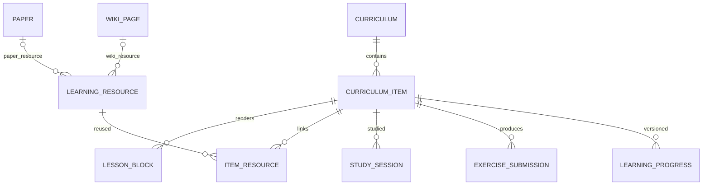

# 데이터 모델·처리 계약 v0.1

이 문서는 [제품 계획](PLAN.md)의 구현 계약 초안이다. 실제 migration, OpenAPI 파일, MCP server, JSON Schema는 아직 구현하지 않았다. 예시의 ID·해시·점수는 설명용이며 실제 논문 분석 결과가 아니다.

## 1. 공통 식별·버전 규칙

모든 주요 엔티티는 UUID, `created_at`, `updated_at`을 사용한다. 수정 가능한 사용자 데이터에는 `revision`과 `archived_at`을 둔다. 시간은 UTC로 저장하고 화면에서 사용자 timezone으로 변환한다. API 수정은 `expectedRevision` 또는 `If-Match`를 받아 오래된 탭의 덮어쓰기를 409로 거부한다.

`paperId`는 논문의 로컬 관리 ID, `paperRevisionId`는 특정 PDF 바이트 내용의 ID다. `contentHash`는 SHA-256으로 계산하고 원본 경로와 독립적이다. 같은 DOI의 preprint와 출판본을 contentHash가 다르다는 이유만으로 다른 연구라고 단정하거나 DOI가 같다는 이유만으로 같은 파일로 합치지 않는다. 버전 연결은 사용자 선택 또는 검증된 metadata로 처리한다. 같은 PDF를 다른 parser/문장 분할기로 다시 처리하는 경우에는 별도 immutable `extractionRunId`를 만든다. 이전 segment·chunk·anchor를 덮어쓰지 않는다.

원문 anchor는 `{paperId, paperRevisionId, extractionRunId, pageNumber, segmentId, sourceRange, rects, coordinateSpace}`를 기본으로 한다. pageNumber는 API에서 1부터 시작한다. 좌표는 unrotated PDF user space와 해당 page box 정보를 보존하고 화면의 scale/rotation으로 변환한다. 모든 문자열 offset은 UTF-16 반열린 구간 `[start, end)`으로 통일하되 기준 문자열은 구별한다. sourceRange는 저장한 정규화 `source_text`, targetRange는 해당 translation generation의 최종 표시용 plain text, itemRange는 그 extraction의 PDF.js `TextItem.str`을 기준으로 한다. Python 정렬 결과의 Unicode codepoint/BPE 인덱스는 bridge에서 이 offset으로 변환한다.

정규화 mapping은 `{extractionRunId, segmentId, sourceRange, items:[{pageNumber,itemIndex,itemTextHash,itemRange}], sourceTextHash}` 형태로 보존한다. 합자·하이픈·공백 때문에 한 구간이 여러 item에 걸릴 수 있다. 번역문은 HTML entity 처리 등 표시용 정규화를 한 번 완료한 뒤 hash·alignment를 만들고 React text로 렌더링한다. 이후 표시 문자열을 조용히 변경하지 않는다. 현재 text layer의 item/text hash가 저장된 추출 mapping과 다르면 단어 overlay를 숨기고 재추출/재연결 상태로 표시한다.

PDF가 변경되면 이전 revision의 anchor를 새 파일에 그대로 그리지 않는다. 원문 quote와 문맥으로 재연결을 제안할 수 있지만 자동 재연결 실패는 `anchor_stale`로 표시한다. 원본 이동/삭제는 `source_missing`이며 annotation·학습 기록을 삭제하지 않는다. 이전 PDF 바이트를 영구 복제하는 기능은 기본 범위에 없으므로 파일 교체 후 과거 revision PDF 열람은 불가능할 수 있다. 기존 추출 텍스트·메모는 보존한다.

## 2. PostgreSQL 논리 모델

표는 기능별 논리 테이블이다. P1에 전체 schema를 한꺼번에 만들지 않고 기능 단계별 migration으로 추가한다. 정렬·검색·FK에 쓰는 필드는 정규 column으로, 추출 metadata·종류별 작은 payload는 versioned JSONB로 저장한다.

| 그룹 | 테이블과 핵심 필드 | 제약/소유권 |
| --- | --- | --- |
| 논문 | `papers(id, title, doi, abstract, language, reading_status, user_priority, current_revision_id, metadata, tags[])` | metadata에는 저자 표시 목록·추출 provenance. 사용자 수정값은 추출 제안보다 우선 |
| 파일 | `paper_sources(id, paper_id, root_id, relative_path, observed_hash, missing_at)` | `(root_id, relative_path)` unique. root_id는 로컬 config에 등록된 root만 허용 |
| 버전 | `paper_revisions(id, paper_id, content_hash, byte_size, page_count, active_extraction_id?, state)` | content_hash 중복 검사; revision 생성과 current pointer 변경 transaction |
| 추출 실행 | `extraction_runs(id, paper_revision_id, extractor_version, segmenter_version, state, completed_at)` | immutable 결과 namespace. 새 추출 성공 후 active pointer 전환 |
| 원문 | `paper_segments(id, extraction_run_id, page_start, order_key, source_text, text_hash, anchors, quality)` | `(extraction_run_id, order_key)` unique. anchors/offset map은 JSONB |
| 검색 단위 | `paper_chunks(id, extraction_run_id, chunker_version, order_key, segment_ranges, text, text_hash, token_count)` | `(extraction_run_id, chunker_version, order_key)` unique. section 경계 우선, 원문 연결 보존 |
| 정리 | `collections`, `collection_papers(collection_id, paper_id, position)` | 다대다 FK·unique. 태그는 우선 papers의 정규화된 text array로 단순화 |
| 주석 | `annotations(id, paper_revision_id, anchor, kind, text, color, revision)` | 사용자의 highlight·note·bookmark. 분석 cache와 독립 보존 |
| reference | `paper_references(id, source_revision_id, raw_text, doi, title, target_paper_id?, evidence_anchor, resolution_state)` | 실제 reference와 식별자 근거. 로컬 target 없는 외부 reference 허용 |
| 관계 | `paper_relations(id, source_paper_id, target_paper_id, type, state, evidence, score, origin, revision)` | self-edge 거부, type별 중복 방지. suggested/accepted/rejected 구분 |
| 분석 | `paper_analyses(id, paper_id, analysis_revision, source_revision_id, snapshot, state, generated_at)` | schema 검증 snapshot. `(paper_id, analysis_revision)` unique |
| 생성 캐시 | `cache_entries(logical_key, operation, latest_requested_generation, current_artifact_id, accessed_at)` | logical_key unique. 현재 결과 pointer와 요청 generation 관리 |
| 생성 결과 | `generated_artifacts(id, logical_key, generation, input_fingerprint, payload, provenance, completed_at)` | `(logical_key, generation)` unique. 완결·검증 성공만 artifact 생성 |
| AI 대화 | `conversations(id, paper_id, scope)`; `messages(id, conversation_id, role, parent_message_id, body, citations, artifact_id?, state)` | 재생성은 같은 user message 아래 새로운 assistant branch. 대화는 영구 기록 |
| embedding | `embedding_profiles(id, provider_snapshot, model_revision, dimensions, distance, preprocessing_version)` | immutable profile. 같은 차원이라도 다른 모델 공간 혼합 금지 |
| index | `index_generations(id, embedding_profile_id, collection_name, state, corpus_manifest, activated_at)` | building/active/retired; 하나의 active generation, 전환 시 revision 검사 |
| jobs/outbox | `jobs(id, kind, dedupe_key, state, input, generation, lease_owner, lease_until, attempts, error_code, progress)` | DB 변경 후 projection/export 작업을 같은 transaction에 기록 |
| job 이벤트 | `job_events(job_id, sequence, type, payload, created_at)` | `(job_id, sequence)` unique. 종료 후 제한된 기간 보관 |
| Wiki | `wiki_pages(id, slug, title, current_revision_id, state)`; `wiki_revisions(id, wiki_id, revision, markdown, source_refs, origin)` | slug unique. 사용자 확정과 AI draft 구분. revision immutable |
| 커리큘럼 | `curricula(id, title, description, revision)` | 단일 사용자 소유, 여러 curriculum 허용 |
| 항목 | `curriculum_items(id, curriculum_id, parent_id?, kind, title, position, content_version, estimated_minutes)` | kind=section/lesson. parent는 같은 curriculum의 section으로 한 단계만 허용 |
| 선수관계 | `curriculum_dependencies(id, curriculum_id, prerequisite_item_id, dependent_item_id)` | 같은 curriculum의 lesson 간 edge, pair unique, cycle/self-edge 거부 |
| 학습 블록 | `lesson_blocks(id, item_id, kind, position, schema_version, payload)` | kind별 payload validation. lesson만 block 소유 |
| 학습 내용 버전 | `lesson_revisions(id, item_id, content_version, snapshot, created_at)` | immutable snapshot에 blocks·질문·완료 기준·자료·읽기 범위 포함 |
| 자료 | `learning_resources(id, kind, title, source_url?, paper_id?, wiki_id?, reading_scope, metadata)` | paper/wiki는 해당 FK 필수, external은 URL 필수; kind별 CHECK |
| 자료 연결 | `item_resources(item_id, resource_id, role, position)` | 다대다 FK, required/optional/assignment 구별 |
| 학습 세션 | `study_sessions(id, item_id, lesson_revision_id, started_at, ended_at, elapsed_seconds, reflection)` | 학습 시점 내용 FK 고정; 사용자가 입력/수정 가능한 시간 |
| 실습 제출 | `exercise_submissions(id, item_id, lesson_revision_id, block_key, session_id?, answers, evidence_path?, commit_ref?, result_note)` | block_key는 당시 immutable snapshot의 블록. 실행은 외부 에디터/터미널 |
| 진도 | `learning_progress(item_id, lesson_revision_id, state, completed_at, next_review_at?)` | `(item_id, lesson_revision_id)` unique. AI 피드백만으로 완료 전환하지 않음 |

초기 저자 정보는 논문별 metadata로 저장한다. 저자 프로필·동명이인 구분·author graph는 범위에 포함하지 않으며 필요할 때 별도 authors/저자 연결 테이블로 migration한다. 논문의 관계·학습 선수관계·자료 연결은 핵심 조회 대상이므로 JSON 안에만 숨기지 않는다.

`jobs`가 transaction outbox 역할을 겸한다. 별도 outbox broker/Redis/Kafka를 두지 않는다. `export_analysis`, `upsert_vectors`, `remove_vectors` 같은 projection job은 호출자 데이터 변경과 같은 DB transaction에서 생성한다.

annotation·대화 인용·분석·학습 snapshot이 참조하는 과거 extraction/segment/lesson revision은 cache 정리로 삭제하지 않는다. 생성 artifact를 직접 참조하는 영속 기록도 참조가 해소되기 전까지 보호하거나 필요한 body·citation·provenance를 기록 자체에 보존한 후 참조를 분리한다. source PDF 원본 byte 보관과 이 텍스트/기록 보존은 별개다.

주요 인덱스는 paper title·doi·reading_status, source 경로, revision hash, chunk의 영어 FTS, annotation revision, relation 양쪽 paper/type, jobs state/lease, curriculum item position이다. 한국어 Wiki는 기본 PostgreSQL FTS의 한국어 형태소 분석을 가정하지 않고 `pg_trgm`/부분검색부터 시작한다. [PostgreSQL FTS](https://www.postgresql.org/docs/current/textsearch-intro.html), [pg_trgm](https://www.postgresql.org/docs/current/pgtrgm.html)

## 3. 커리큘럼/FE 확장 계약



초기 block kinds는 `markdown`, `paper_reading`, `wiki_reading`, `self_explanation`, `exercise`, `checklist` 여섯 개다. FE registry는 `{kind → validator + renderer + editor}`를 제공한다. 새 lesson과 기존 종류 block 추가는 데이터 변경만으로 반영된다. 알 수 없는 kind/schemaVersion은 안전한 읽기 전용 placeholder로 표시하고 데이터를 버리지 않는다.

`position`은 단순 정수로 시작한다. 재정렬 요청은 해당 목록의 모든 ID 순서를 받아 transaction으로 position을 다시 매긴다. 선수 edge는 표시 순서와 독립이며 edge 추가 시 같은 curriculum에서 cycle을 확인한다. 소규모 curriculum은 transaction 단위 잠금으로 동시 탭 수정을 직렬화한다.

학습 내용 수정은 `content_version`을 올리고 같은 transaction에서 `lesson_revisions` snapshot을 만든다. 당시 block·질문·완료 기준·자료 연결·읽기 범위를 포함하고 연결한 Wiki/PDF의 revision도 고정한다. 외부 URL 자료는 당시 제목·URL·지정 범위를 보관하되 외부 사이트 본문까지 영구 보존한다고 보장하지 않는다. session·submission·progress는 snapshot FK를 참조하여 과거 질문과 기준을 복원한다. 변경된 lesson은 `업데이트 있음`을 보여준다. archive하면 기본 목록에서 숨기고 연결된 메모·Wiki·학습 기록은 유지한다. section archive는 포함 lesson 목록을 명시적으로 보여주는 동작이며, 다른 curriculum이나 공유 resource를 연쇄 삭제하지 않는다.

## 4. 생성 결과와 캐시 계약

기본 지문은 다음 입력을 canonical JSON으로 직렬화하여 hash한다. 비밀키 원문은 지문·로그 어디에도 포함하지 않는다. provider instance ID와 credential revision은 설정 변경을 구별하는 비밀이 아닌 식별자다.

```text
operation + inputSchemaVersion
paperRevisionId + contentHash + extractionRunId + extractionVersion
inputTextHash / selectedSegmentIds / targetLanguage
providerInstanceId + credentialRevision + modelId + modelRevision
promptVersion + generationParameters + outputSchemaVersion
operation-specific context fingerprint
```

| 종류 | 추가 key 재료 | 무효화/재생성 범위 |
| --- | --- | --- |
| translation | source/target language, segment source hash, translator config version | 해당 source segment의 번역 |
| alignment | 양쪽 텍스트 hash, translation generation, tokenizer/aligner/model revision | 대응 번역 generation의 단어 mapping |
| embedding | chunk/query text hash, embedding profile ID, query/document prefix | 해당 vector; profile 변경 시 새 index |
| summary | 요약 대상 chunk hash manifest, summary template, coverage | 해당 논문/section 요약 |
| chat | conversationId, user message, parent branch hash, 검색 scope·context chunk/hash, retrieval/index version | 동일 turn·동일 문맥 답변만 재사용 |
| relation analysis | 두 paper revision, 후보검색 profile, relation prompt, 사용자/커리큘럼 관련 revision | 영향받는 관계만 |

Google Basic 응답에 불변 backend model revision이 없을 수 있다. 이때 service translation config version과 생성 일시를 기록하고 upstream 모델 변경 자동 감지를 약속하지 않는다. 같은 이유로 모델 digest를 제공하지 않는 LM Studio는 사용자가 설정하는 `modelRevision` 또는 `모델 변경됨` 버튼을 제공한다.

기본 요청은 `cacheMode: "use"`, 앱의 재생성은 `cacheMode: "refresh"`다. 재생성 요청에는 새 `requestId`가 붙고 네트워크 재전송은 같은 ID를 재사용한다. HTTP는 `Idempotency-Key`, MCP는 tool input의 `requestId`로 동일 규칙을 적용한다.

1. 서버는 입력·권한·network policy를 검증한다. 기존 결과 조회는 외부 호출이 필요 없으면 local-only에서도 가능하다.
2. `use`에서 fresh cache를 찾으면 반환한다. 동일 논리 키의 진행 중 작업이 있으면 합류한다.
3. `refresh`는 atomic하게 requested generation을 증가시키고 해당 generation job을 한 번 등록한다. 같은 requestId의 재전송은 새 generation을 만들지 않는다.
4. 작업은 입력 snapshot으로 실행한다. 늦게 완료된 이전 generation은 최신 포인터를 덮어쓰지 못한다.
5. 성공 결과를 schema 검증하고 artifact를 기록한 뒤, 해당 generation이 여전히 최신 요청이면 current pointer를 교체한다.
6. 실패/취소는 기존 성공 artifact를 유지한다. 입력 fingerprint가 다른 구 결과는 `stale`로만 제공하며 새 결과로 위장하지 않는다.

다른 모델·paper revision으로 논리 키가 바뀌어도 화면의 현재 결과나 analysis snapshot은 오래된 작업이 덮어쓸 수 없다. publish 시에는 `(paperId, operation, scope)`의 최신 요청 revision과 현재 source/config fingerprint도 함께 비교한다. 오래된 결과는 자신의 immutable artifact로만 남긴다.

번역에서 위 scope의 실제 publish 단위는 `(paperRevisionId, extractionRunId, sourceSegmentId, targetLanguage)`다. 문장/페이지/전체논문 요청은 이 canonical segment 집합으로 전개하는 부모 작업이다. 요청 등록 transaction에서 각 segment의 generation을 예약하고 worker 실행 시점에 뒤늦게 새 generation을 발급하지 않는다. 겹치는 범위는 같은 segment의 generation 계열을 사용하고 최신 요청만 그 segment를 교체한다. 페이지 경계를 넘는 문장도 하나의 segment로 dedupe한다. 전체논문 재번역 중 현재 페이지를 다시 번역해도 늦게 끝난 전체 작업이 그 페이지의 최신 결과를 덮어쓸 수 없다.

번역과 정렬은 같은 translation generation을 공유한다. 번역이 먼저 끝나면 sentence highlight가 가능한 결과를 내고 alignment 상태를 `pending`으로 표시한다. 이전 번역의 word ranges를 새 번역에 붙이지 않는다. alignment 실패 시 번역은 보존하되 `alignment_failed`와 재시도를 제공한다. 완성된 mapping만 해당 번역 generation에 원자적으로 연결한다.

채팅 stream 중간 토큰은 임시 job event다. `done` 이전 연결 중단/오류는 완결 캐시로 저장하지 않는다. 이미 완료된 대화 메시지와 그 인용은 cache eviction과 독립해서 보존한다. 재생성한 새 assistant branch가 선택되면 이후 대화는 그 branch를 parent로 삼고 기존 이후 branch는 기록으로 남긴다.

수동 refresh는 지정한 결과를 새로 계산한다. PDF 추출/embedding 같은 변경 없는 입력 준비 작업까지 모두 재실행하지 않는다. 전체 pipeline 재분석은 별도 `scope: "paper"` 요청으로 명시한다.

## 5. Jobs·stream·실패 처리

상태는 `queued → running → succeeded | failed | cancelled`이며 사용자 설정 부재는 `blocked_config`로 구별한다. worker heartbeat/lease와 attempts를 보관하여 프로세스 종료 후 작업을 재확인한다. `SELECT … FOR UPDATE SKIP LOCKED`로 여러 consumer에 같은 queued job이 배정되지 않도록 한다. 초기 worker 수·무거운 inference 동시성은 1이다. [PostgreSQL SELECT locking](https://www.postgresql.org/docs/current/sql-select.html)

짧은 metadata 조작은 동기 처리하고, 번역/생성/import는 HTTP 202와 job handle을 반환한다. FE는 `/api/v1/jobs/{id}/events` SSE 또는 polling으로 진행 상황을 조회한다. DB에는 token 하나마다 행을 쓰지 않고 짧은 시간 단위로 delta를 묶어 sequence를 기록한다. SSE 재연결은 남아 있는 이벤트를 재전달하거나 최종 artifact로 복구한다. 완료 후 임시 event는 보존 정책에 따라 정리한다.

일반 UI stream 연결 종료는 작업 취소와 같지 않다. 사용자가 `취소`를 누르면 cancel endpoint로 명시한다. MCP에는 짧게 job handle을 반환하므로 프로토콜 stream 수명과 영속 background job 수명을 혼동하지 않는다. 외부 provider 취소는 best effort이며 이미 처리된 요청 비용을 되돌린다고 표시하지 않는다.

429/명확한 일시 장애는 provider별 제한 안에서 지수 backoff·jitter를 적용한다. 요청이 provider에 전달된 뒤 연결이 끊겨 성공 여부를 모르는 경우는 `outcome_unknown`으로 보관한다. upstream idempotency가 없는 유료 호출의 exactly-once를 보장하거나 무제한 자동 재호출하지 않는다. 사용자에게 재요청 여부를 선택할 수 있는 실패 상태를 제공한다.

job input에는 provider/모델/프롬프트 snapshot을 저장하지만 실행 시 최신 비밀값 폐기·권한·network policy를 다시 확인한다. 이미 폐기한 credential이나 뒤늦게 local-only로 바뀐 정책을 queued job이 우회하지 못하게 한다.

## 6. Qdrant·검색·재색인

하나의 active embedding profile과 index generation으로 시작한다. Qdrant collection은 `papers_{profileShortId}_{generation}` 규칙으로 생성하며 point payload는 `paperId`, `paperRevisionId`, `extractionRunId`, `chunkId?`, `kind: paper|chunk`, `textHash`다. 사용자 이름·API key·절대 파일 경로를 vector payload에 저장하지 않는다.

논문 대표 vector는 제목·초록 등 정해진 입력으로 만들고 chunk vector는 본문으로 만든다. `kind` filter로 용도를 구별한다. metadata에 제목·초록이 없으면 가용 본문으로 만들고 입력 provenance를 표시한다. 질의/문서의 embedding model·prefix·정규화가 같은 profile이어야 한다. Qdrant의 vector dimension·distance 규칙과 모델별 embedding 요구를 따른다. [Qdrant collections](https://qdrant.tech/documentation/manage-data/collections/), [Ollama embedding 안내](https://docs.ollama.com/capabilities/embeddings)

retrieval은 PostgreSQL keyword 결과와 Qdrant vector 결과를 순위 기반으로 합친 뒤 같은 chunk를 dedupe하고 인접 문맥을 추가한다. 서로 다른 종류의 raw score를 더하지 않는다. 초기 `topK=8`, chunk 약 600~1,000 tokens와 overlap 약 100 tokens는 실험 시작값이며 모델 context와 실제 PDF section에 맞춰 조절한다. query embedding도 cache한다. vector가 준비되지 않으면 keyword 검색으로 동작하고 제한 상태를 표시한다.

재색인 절차는 새 immutable profile 생성 → 새 collection에 generation 구성 → manifest별 입력 hash/차원 확인 → 최신 paper revision과 조정 → active pointer transaction 전환이다. 재색인 중 새 문서 변경은 projection job으로 두 generation에 반영하거나 전환 전 따라잡는다. 구 모델을 사용할 수 없으면 구 공간에 새 모델 query vector를 넣지 않고 keyword fallback한다.

검색 결과는 DB의 현재 paper revision·active extraction·archive 여부를 다시 확인하고 오래된 point를 제외한다. active 전환 직전에 corpus manifest가 맞는지 검증한다. 구 collection 정리는 복구 가능한 보존 기간 이후 명시적 유지보수 작업으로 진행한다.

논문 archive·내용 변경은 Qdrant 제거/교체 job을 transaction outbox로 발행한다. 관계 재평가는 새 논문 상위 후보·명시적 reference 대상·기존 직접 연결된 논문에 제한한다. 전체 그래프 전수 AI 재분석은 수동 유지보수 작업으로만 가능하다.

## 7. 분석 JSON 계약

물리 경로: `/artifacts/analysis/{paperId}/{safePaperStem}_analysis.json`. safe stem은 경로 구분자·제어문자를 제거하고 길이를 제한한다. 표시 제목 수정만으로 물리 경로가 불안정하게 바뀌지 않도록 최초 파일 stem을 보존한다.

```json
{
  "schemaVersion": "1.0",
  "paperId": "paper-example-a",
  "paperRevisionId": "revision-example-a2",
  "extractionRunId": "extraction-example-v2",
  "contentHash": "sha256:example",
  "analysisRevision": 3,
  "status": "partial",
  "generatedAt": "2026-09-08T00:00:00Z",
  "source": { "rootId": "papers", "relativePath": "systems/example.pdf" },
  "bibliography": { "title": "Example Paper", "authors": [], "year": null, "doi": null },
  "summary": { "artifactId": "artifact-example", "text": "설명용 요약", "citationRefs": [] },
  "topics": ["distributed-systems"],
  "importance": {
    "userPriority": 4,
    "suggestedPriority": null,
    "reasons": ["활성 커리큘럼의 읽기 자료"],
    "scope": "personal-library"
  },
  "relations": [{
    "targetPaperId": "paper-example-b",
    "type": "similar_to",
    "state": "suggested",
    "origin": "vector",
    "similarity": { "metric": "cosine", "score": 0.81, "embeddingProfileId": "profile-example" },
    "evidenceRefs": []
  }],
  "references": [{
    "rawText": "Example reference entry",
    "doi": null,
    "targetPaperId": null,
    "resolutionState": "unresolved",
    "evidenceRef": { "pageNumber": 8, "segmentId": "segment-example" }
  }],
  "curriculumLinks": [{ "curriculumId": "cs-foundations", "itemId": "distributed-basics" }],
  "provenance": {
    "extractorVersion": "pdf-extractor-v1",
    "embeddingProfileId": "profile-example",
    "analysisPromptVersion": "paper-analysis-v1",
    "modelRevision": "example-model-revision"
  },
  "coverage": { "parsedPages": 8, "totalPages": 8, "aiAnalyzedPages": 2 },
  "warnings": ["일부 section은 AI 분석 전입니다."]
}
```

실제 schema의 ID는 UUID를 사용한다. 위 가독성용 문자열은 production validation 샘플이 아니다. `status`는 pending/partial/complete/failed, coverage는 처리한 실제 범위를 나타낸다. 미검증 citation을 확정 reference처럼 채우지 않는다. API key·채팅 전문·개인정보를 분석 JSON에 자동 포함하지 않는다.

JSON은 DB snapshot의 export이며 기본적으로 외부 파일 편집을 자동 역수입하지 않는다. metadata·관계·중요도 수정은 UI/REST/MCP에서 수행한다. JSON 직접 수정 import는 schema 검증·revision 충돌 해결을 추가해야 하므로 후속 범위다.

관계 변경 transaction에서 관련 논문들의 analysis revision과 export job을 함께 만든다. export 직전 최신 analysis revision을 재확인하고 오래된 job의 파일 덮어쓰기를 막는다. 임시 파일 작성·rename 실패는 export 상태를 failed로 남기고 DB 변경을 되돌리거나 성공한 이전 파일을 삭제하지 않는다. 새 파일·Qdrant 동기화 상태를 UI에 표시한다.

## 8. REST API v1

공통 요청은 JSON, 목록은 cursor pagination이다. 일반 결과는 `{data, meta:{requestId, revision?, cache?, jobId?}}`로 반환한다. PDF와 event stream은 각각 전용 content type을 사용한다. cache metadata는 hit/miss/stale, artifactId, generatedAt, provider 표시 정보를 포함한다.

오류는 `application/problem+json`과 `type/title/status/detail/code/requestId`를 사용한다. stack trace·비밀값·호스트 절대 경로를 외부 응답에 넣지 않는다. 400/422 입력 오류, 401/403 인증·권한, 404 없음, 409 revision conflict, 429 예산·제한, 503 provider unavailable을 구별한다. [RFC 9457](https://www.rfc-editor.org/rfc/rfc9457)

| Resource | Endpoint 계획 | 동작 |
| --- | --- | --- |
| 라이브러리 | `GET /library/files`; `POST /library/scans` | 마운트 범위 목록·변경 검사 |
| 논문 | `GET,POST /papers`; `GET,PATCH,DELETE /papers/{id}`; `POST /papers/{id}/restore` | 검색·등록·수정·archive·복구 |
| PDF | `GET /papers/{id}/file?revision=...` | 승인된 파일만 HTTP Range/ETag streaming; source 불일치 409 |
| 추출 | `GET /papers/{id}/pages/{page}/segments`; `POST /papers/{id}/index-jobs` | 원문·anchor, 재추출/색인 |
| 정리 | `GET,POST /collections`; `PATCH,DELETE /collections/{id}`; `PUT,DELETE /collections/{id}/papers/{paperId}` | 컬렉션과 포함 관계 |
| 주석 | `GET,POST /papers/{id}/annotations`; `PATCH,DELETE /annotations/{id}` | note/highlight/bookmark |
| 번역 | `GET /papers/{id}/translations`; `POST /papers/{id}/translation-jobs` | 조회와 생성/refresh 분리 |
| 요약 | `GET /papers/{id}/summaries`; `POST /papers/{id}/summary-jobs` | 범위/템플릿별 요약 |
| 대화 | `GET,POST /papers/{id}/conversations`; `GET,DELETE /conversations/{id}`; `POST /conversations/{id}/messages` | 지속 대화; DELETE는 archive |
| 재답변 | `POST /messages/{id}/regenerations` | user turn의 새 assistant branch |
| 분석 | `GET /papers/{id}/analysis`; `POST /papers/{id}/analysis-jobs` | 상태·JSON 조회/재분석 |
| 관계 | `GET /papers/{id}/relations`; `POST /relations`; `PATCH,DELETE /relations/{id}` | 근거·추천/확정 상태 수정 |
| reference | `GET /papers/{id}/references`; `PATCH /references/{id}` | 미해결 식별자/target 수정 |
| 검색 | `GET /search?q=...&scope=...`; `POST /search/semantic` | GET은 keyword 조회, embedding이 필요한 검색은 POST |
| Wiki | `GET,POST /wiki`; `GET,PATCH,DELETE /wiki/{id}`; `GET /wiki/{id}/revisions`; `POST /wiki/{id}/restore` | 문서·revision·archive 복구 |
| 커리큘럼 | `GET,POST /curricula`; `GET,PATCH,DELETE /curricula/{id}`; `POST /curricula/{id}/restore` | curriculum CRUD |
| 항목 | `POST /curricula/{id}/items`; `PATCH,DELETE /curriculum-items/{id}`; `POST /curriculum-items/{id}/restore`; `PUT /curricula/{id}/order` | 단원·section·정렬 |
| 선수관계 | `POST /curricula/{id}/dependencies`; `DELETE /curricula/{id}/dependencies/{edgeId}` | cycle 검증 |
| 블록·자료 | `GET,POST /curriculum-items/{id}/blocks`; `PATCH,DELETE /lesson-blocks/{id}`; `GET,POST /resources`; `PATCH,DELETE /resources/{id}` | 동적 학습 자료 CRUD |
| 자료 연결 | `PUT,DELETE /curriculum-items/{id}/resources/{resourceId}` | 동일 자료를 여러 lesson에 연결 |
| 학습 | `GET,POST /study-sessions`; `GET,PATCH,DELETE /study-sessions/{id}`; `GET,POST /exercise-submissions`; `GET,PATCH,DELETE /exercise-submissions/{id}`; `PUT /curriculum-items/{id}/progress` | 시간·답안·산출물·완료·복습일; DELETE는 기록 archive |
| 설정 | `GET,PATCH /configuration`; `POST /providers/{id}/tests`; `PUT,DELETE /credentials/{id}` | 일반 설정, capability/실행 test, 비밀값 write-only |
| 작업 | `GET /jobs/{id}`; `GET /jobs/{id}/events`; `POST /jobs/{id}/cancel`; `POST /jobs/{id}/retry` | 진행·stream·취소·재시도 |
| 유지보수 | `GET /usage`; `POST /cache/evictions`; `POST /indexes/rebuilds`; `POST /backups`; `POST /restores/validate` | 사용량·명시적 정리·재색인·백업 검증 |
| 통합 | `GET /openapi.json`; `POST /access-tokens`; `DELETE /access-tokens/{id}` | machine-readable 계약, scope token 발급·폐기 |

표의 `/` 경로에는 모두 `/api/v1` prefix가 붙는다. 권한별 노출은 API에서 강제하고 UI hiding만으로 보호하지 않는다. provider URL/credential reference는 configuration을 통해 등록하고 매번 생성 요청에서 임의 URL을 받지 않는다. `GET` 조회가 cache miss 때문에 생성·유료 요청을 시작하지 않는다.

번역 작업 예시:

```json
{
  "paperRevisionId": "revision-id",
  "scope": { "type": "page", "pageNumber": 3 },
  "targetLanguage": "ko",
  "cacheMode": "refresh",
  "requestId": "unique-action-id"
}
```

생성 작업 응답은 `202 {data:{jobId,state:"queued"},meta:{requestId}}`이고 cache hit이면 `200 {data:{artifactId,...},meta:{cache:{status:"hit"},requestId}}`다. 프론트엔드는 두 경로를 같은 작업 결과 컴포넌트로 처리한다.

## 9. MCP 계약과 권한

기본 MCP transport는 `/mcp`의 Streamable HTTP, protocol은 `2026-07-28`, 공식 TypeScript SDK v2다. JSON-RPC method·headers·metadata·결과 외피는 SDK가 처리한다. domain operation의 입력 validation과 출력 DTO는 REST와 공유한다. 최신 규격은 POST 중심이고 이전 protocol session/GET stream을 사용하지 않는다. [공식 SDK](https://github.com/modelcontextprotocol/typescript-sdk), [transport](https://modelcontextprotocol.io/specification/2026-07-28/basic/transports/streamable-http)

SDK 패키지 버전만 올려서는 modern protocol이 자동 활성화되지 않는다. Next.js의 Web Request/Response에는 공식 `createMcpHandler`의 fetch entry를 연결하고, 최초 지원 범위는 `legacy: "reject"`로 명시한다. client test도 modern version negotiation을 명시한다. 이전 client가 필요하면 SDK의 stateless compatibility를 별도로 검증하고 활성화한다. [v2 protocol migration](https://ts.sdk.modelcontextprotocol.io/v2/migration/support-2026-07-28)

| MCP tool 그룹 | 예시 tool | scope |
| --- | --- | --- |
| 논문 조회 | `papers_search`, `papers_get`, `papers_get_segments`, `papers_get_analysis`, `papers_get_relations` | `library:read` |
| 논문 관리 | `papers_import`, `papers_update`, `papers_archive`, `papers_restore`, `annotations_upsert`, `relations_update` | `library:write` |
| 생성 요청 | `papers_translate`, `papers_summarize`, `paper_chat`, `papers_analyze` | `ai:run` + 해당 읽기 권한; 외부 호출은 `external:invoke`도 필요 |
| Wiki | `wiki_search`, `wiki_get`, `wiki_upsert`, `wiki_archive`, `wiki_restore` | `wiki:read` 또는 `wiki:write` |
| 커리큘럼 | `curricula_get`, `curricula_create`, `curricula_update`, `curriculum_items_upsert`, `curriculum_items_archive`, `curriculum_items_reorder` | `learning:read` 또는 `learning:write` |
| 학습 | `study_sessions_create`, `exercise_submissions_upsert`, `learning_progress_update` | `learning:write` |
| 작업 | `jobs_get`, `jobs_cancel` | 원 작업 실행 권한과 소유 범위 |

MCP resource는 `paper://{id}/metadata`, `paper://{id}/analysis`, `paper://{id}/segments/{segmentId}`, `wiki://{id}`, `curriculum://{id}`를 제공한다. 큰 PDF 전체를 base64로 매번 tool 응답에 넣지 않고 승인된 페이지/segment와 로컬 Reader deep link를 반환한다.

각 tool에 JSON Schema 입력·출력, 설명, readOnly/destructive/idempotent 동작 hint를 선언한다. hint는 권한을 대체하지 않는다. domain 결과는 `structuredContent`로 제공하며 호환을 위해 동일 내용을 text content로도 반환할 수 있다. 도메인 실패는 `isError`와 공통 error code, 잘못된 JSON-RPC는 protocol error로 구별한다. 규격별 외피는 REST envelope와 별개다. [MCP tools](https://modelcontextprotocol.io/specification/2026-07-28/server/tools)

AI/번역 tool은 즉시 job handle 또는 cache 결과를 반환한다. Agent는 `jobs_get`으로 완료를 확인한다. tool requestId는 idempotency를 위한 앱 수준 필드이며 JSON-RPC id나 protocol session을 영속 job ID로 사용하지 않는다.

최초 발급 token 기본값은 읽기 전용이다. 수정/생성 scope는 사용자가 설정에서 부여한다. 외부 전송 권한은 전역·논문별 정책보다 넓어질 수 없다. 같은 PC의 Agent라도 연동된 외부 모델에 tool 결과를 전달할 수 있으므로 configuration에 제공 데이터 범위가 보이게 한다. secret/config 관리·임의 path·쉘·SQL은 MCP에 노출하지 않는다.

호스트 publish는 localhost에 한정한다. Origin이 있으면 allowlist를 검증하고, Origin이 없는 native client도 Host·Bearer token 검증을 거친다. 모든 외부 agent와의 호환을 추정하지 않고 실제 client 하나 이상에서 discovery·tools/list·조회·수정·권한 거절을 검증한다. 이전 MCP client는 필요할 때 별도 검증된 compatibility transport를 추가하며 v1/v2 메시지 규칙을 섞지 않는다.
