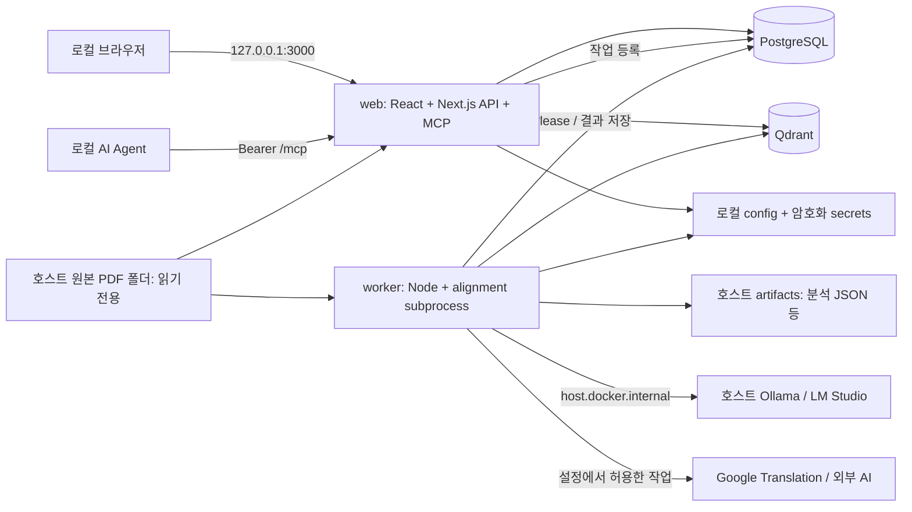

# Thesis Partner — 제품 및 구현 계획 v0.1

작성일: 2026-09-08. 상태: 구현 전 설계안. 공식 문서 확인과 설계 결정을 구분하며, 성능·정확도 수치는 아직 측정하지 않았다.

## 1. 목표와 범위

한 명의 개발자가 개인 PC에서 `논문 수집 → 원문·번역 읽기 → 질문·메모 → 개념 Wiki → 커리큘럼 실습 → 복습`을 수행한다. SaaS와 같은 탐색·설정 UX를 제공하되 계정 조직, 결제, 공유 서버, 멀티테넌시를 만들지 않는다.

초기 설계 규모는 사용자 1명, PDF 수백 편, 동시 무거운 로컬 AI 작업 1개다. 최초 성능 검증은 논문 100편으로 시작하고 500편에서 검색·재색인·백업을 확인한다. PC 메모리와 선택 모델에 따라 제한을 조정한다. 모델을 포함한 실행 메모리나 처리 시간을 지금 보장하지 않는다.

기본 UI·번역 목표 언어는 한국어, 주 입력은 텍스트 선택이 가능한 영어 PDF다. 다른 언어는 설정 가능하게 하되 최초 단어 정렬 검증은 영어↔한국어에 집중한다. 스캔 PDF도 등록·열람할 수 있고 텍스트 기반 기능은 `OCR 필요`로 표시한다.

첫 버전 완료 범위에는 요청한 번역, 단어·문장 hover, 캐시와 강제 재요청, 외부/로컬 AI, 분석 JSON, 별도 vector DB, Wiki·커리큘럼 CRUD, 실제 학습 기록, 비밀 설정 보존, REST API와 MCP가 모두 포함된다. OCR, 수식·그림 자체의 AI 해석, 대규모 논문 수집, 브라우저 코드 실행, 협업은 후속 범위다.

## 2. 기술 결정

| 영역 | 채택 | 이유 및 경계 |
| --- | --- | --- |
| FE | React + TypeScript, Next.js App Router 안의 UI | React 화면과 API를 같은 origin으로 서비스. 별도 FE 배포 컨테이너를 추가하지 않음 |
| BE | Next.js Route Handlers, Node runtime | `/api/v1` 공개 계약. 도메인 로직은 route 밖에서 재사용 |
| PDF | PDF.js canvas + text layer + highlight overlay | 원본 레이아웃, 선택 텍스트, 페이지 좌표를 함께 다룸 |
| RDB | PostgreSQL 18 | 관계, 트랜잭션, Wiki revision, 학습 기록, 영속 캐시·작업 관리 |
| DB 접근 | Drizzle ORM + SQL migration | TS 모델과 SQL을 가까이 유지. FK·unique·check는 DB에도 선언 |
| Vector DB | Qdrant, 독립 Compose 서비스 | 별도 vector DB 요구 충족. 논문·chunk 검색용 파생 인덱스 |
| 비동기 처리 | Node worker + PostgreSQL jobs/outbox | 긴 PDF 처리·번역·요약을 HTTP 요청 수명에서 분리. 초기 Redis 없이 운영 |
| 단어 정렬 | worker 내부 Python subprocess + SimAlign/mBERT 후보 | 새로운 서비스 없이 로컬 alignment. P0에서 CPU/한영 품질 검증 |
| AI | provider adapter, cloud API key / Ollama / LM Studio | chat 모델과 embedding 모델을 각각 설정 |
| 프로토콜 | REST + OpenAPI, MCP Streamable HTTP | 공유 DTO·서비스·권한 정책, 전송 형식은 각 표준 준수 |
| 실행 | OrbStack + 표준 `docker compose` | macOS bind mount, named volume, host AI 연결 |

Next.js는 Route Handlers와 자체 Docker 호스팅을 공식 지원한다. RDB의 정규 관계를 기본으로 하고 추가 메타데이터·종류별 작은 payload에만 JSONB를 사용한다. PostgreSQL JSONB 지원 자체가 관계·제약 설계를 대체하지는 않는다. [Next.js Route Handlers](https://nextjs.org/docs/app/getting-started/route-handlers), [Self-hosting](https://nextjs.org/docs/app/guides/self-hosting), [PostgreSQL JSON](https://www.postgresql.org/docs/current/datatype-json.html), [Drizzle](https://orm.drizzle.team/docs/overview)

SQLite는 개인 서비스에 적합한 대안이지만, 이번에는 명시적인 RDB 확장 요구와 web/worker 동시 갱신·작업 lease를 고려하여 PostgreSQL을 선택한다. pgvector 단독 구성은 서비스 수를 줄일 수 있으나, 별도 vector DB라는 요구에 따라 Qdrant로 결정한다. 별도 검색 엔진이나 graph DB는 추가하지 않는다.

정확한 패키지 patch 버전·이미지 digest는 P0에서 실제 호환 조합을 검증하고 lockfile에 고정한다. `latest`를 운영 설정에 남기지 않는다.

## 3. 배치와 저장 위치



| 서비스 | 역할 | 호스트 공개 포트 | 영속 저장 |
| --- | --- | --- | --- |
| `web` | UI, API, PDF streaming, 작업 이벤트, MCP | `127.0.0.1:3000:3000`만 | PDF RO, config RW, artifacts RO, master key RO |
| `worker` | import, 추출, AI, alignment, 관계, export | 없음 | PDF RO, artifacts RW, config/secrets RO, master key RO, 모델 cache RW |
| `postgres` | 기준 데이터·캐시·jobs | 없음 | named volume |
| `qdrant` | vector 검색 | 없음 | named volume |

DB/Qdrant는 내부 네트워크에만 연결한다. web/worker의 외부 통신은 필요한 provider adapter로 제한한다. 마이그레이션은 같은 앱 이미지의 일회성 명령으로 실행하고 성공 후 web/worker를 시작한다. healthcheck, DB 연결 재시도, 종료 시 작업 lease 반환을 둔다.

원본은 `${PAPERS_DIR}:/library:ro`, 결과는 `${APP_DATA_DIR}/artifacts:/artifacts`, 설정은 `${APP_DATA_DIR}/config:/config`로 구분한다. 이들은 향후 Compose용 예시 변수이며 실제 사용자 경로를 저장소에 기입하지 않는다. PostgreSQL·Qdrant named volume은 컨테이너 재생성과 분리한다.

분석 파일 경로는 `/artifacts/analysis/{paperId}/{safePaperStem}_analysis.json`이다. 사용자가 요청한 `thsisName_analysis.json`의 논문별 파일 명명 의도를 반영한다. paperId 디렉터리로 같은 파일명 충돌을 방지한다. 원본 PDF 옆 저장은 읽기 전용 mount와 충돌하므로 기본 결과 폴더를 따로 지정한다.

브라우저의 폴더 선택만으로 Docker bind mount를 추가할 수는 없다. Configuration은 이미 마운트된 라이브러리의 하위 경로 선택·재검색을 지원하고, 호스트 루트 경로 변경은 로컬 설정/Compose 갱신과 컨테이너 재생성이 필요한 작업으로 안내한다. 소스 폴더는 한 개로 시작하고 여러 하위 디렉터리를 사용할 수 있다.

OrbStack는 `host.docker.internal`과 host networking을 문서화한다. 우선 bridge 구성으로 실제 호스트 AI 접근을 검증한다. 연결 실패 시 주소·서비스 상태·방화벽을 진단하고 LAN bind를 자동으로 열지 않는다. OrbStack의 포트 LAN 노출 설정도 로컬 접근 검수에 포함한다. [Container networking](https://docs.orbstack.dev/docker/network), [Host networking](https://docs.orbstack.dev/docker/host-networking)

향후 소스 배치는 다음 정도로 제한한다. 아래는 실제 생성된 코드가 아닌 예정 구조다.

```text
apps/web/                 React 화면, Next.js REST/MCP transport
apps/worker/              jobs 처리, PDF pipeline, Python alignment bridge
packages/domain/          논문·학습·Wiki 서비스, 권한·network policy
packages/contracts/       DTO validation, JSON Schema, OpenAPI 생성
packages/db/              PostgreSQL schema와 migration
packages/providers/       Google / cloud / Ollama / LM Studio adapters
compose.yaml
docs/
```

## 4. 화면과 읽기 경험

주 메뉴는 `라이브러리 / 학습 / Wiki / 설정` 네 개다. 처리 작업과 사용량은 전역 상태 버튼에서 확인한다. 별도 관리자 대시보드는 만들지 않는다.

Moonlight의 공식 문서에서 페이지 번역, 번역문 hover와 원문 문장 연결, 선택 구간 설명, 하이라이트·노트를 확인했다. 이 읽기 흐름을 참고하되 고유 로고·이미지·문구·디자인 자산은 사용하지 않는다. [Moonlight 번역](https://docs.themoonlight.io/articles/5160799-translation), [설명](https://docs.themoonlight.io/articles/0764566-explanation), [제품 소개](https://docs.themoonlight.io/articles/4008366-whats-moonlight)

라이브러리는 목록 중심으로 제목·저자·연도·태그·읽기 상태·분석 상태를 보여준다. 기본 필터는 `읽을 것 / 읽는 중 / 완료`, 컬렉션과 태그다. 상세 화면에서 연관 논문과 reference를 목록으로 보여주고 전체 그래프 시각화는 후속 기능으로 둔다.

Reader는 좌측 접이식 목차, 중앙 원본 PDF, 우측 작업 패널로 구성한다. 기본 비율은 원본 약 60%, 패널 약 40%이며 조절할 수 있다. 우측은 `번역 / 요약 / 채팅 / 메모` 탭이다. PDF toolbar에는 페이지·확대·검색, 패널 toolbar에는 모델·캐시 상태·범위가 명시된 재생성 버튼을 둔다. 다크 모드여도 PDF 원본 배경은 보존한다.

책갈피, 마지막 읽던 페이지·확대율 복원, 페이지 인용 클릭 이동, 선택 구간 메모, 미처리/실패 이유 표시는 v1에 포함할 작은 추가 기능이다. hover는 keyboard focus와 클릭 고정으로도 접근 가능하며 문장과 단어 강조를 색상뿐 아니라 테두리/밑줄로 구별한다.

## 5. PDF와 번역·단어 연결

Google 번역은 **Cloud Translation Basic v2** 공식 API로 시작한다. API key를 서버에서 보관한다. Advanced v3는 API key 인증을 지원하지 않으므로 이번 기본 구현과 혼용하지 않는다. Google Cloud 프로젝트·API 활성화·결제 설정을 전제로 하며, 무료 웹 번역 페이지의 iframe·비공식 scraping을 엔진으로 사용하지 않는다. 번역 패널에는 Google attribution을 반영한다. [인증](https://docs.cloud.google.com/translate/docs/authentication), [설정](https://docs.cloud.google.com/translate/docs/setup), [Attribution](https://docs.cloud.google.com/translate/attribution)

처리 과정은 다음과 같다.

1. PDF 내용 해시와 revision을 만들고 PDF.js로 페이지별 text items·좌표를 추출한다. 동일 PDF를 재추출할 때도 별도 immutable extraction run을 만들어 과거 anchor를 보존한다.
2. column·문단 읽기 순서를 복원하고 줄바꿈 하이픈을 정규화한다. 원본 item/문자 offset과 정규화 문자열 사이의 mapping을 보존한다.
3. 각 원문 segment에 `sentenceId`, page anchors, source ranges를 부여한다. 페이지를 가로지르는 문장도 anchors 배열로 표현한다. 긴 문장은 API 제한 안에서 subsegment로 나누고 parent ID를 보존한다.
4. 문장/segment마다 하나의 번역 입력을 만들고 batch 요청의 순서를 저장한다. 번역 결과 하나가 여러 문장으로 나뉘어도 하나의 source segment와 연결한다. 응답 개수 불일치·누락은 해당 batch 실패로 처리한다.
5. 번역 문장과 원문에 로컬 단어 정렬을 적용하여 `targetRange → sourceRanges[]`를 만든다. 이를 번역 결과·버전과 함께 저장한다.
6. FE는 text layer의 문자 범위와 PDF 좌표 변환으로 강조한다. 확대·회전·화면 배율 변화 시 overlay를 재계산한다.

PDF.js의 TextItem은 텍스트와 위치 정보를 제공하지만 item 하나가 단어 또는 문장이라는 보장은 없다. 추출 순서가 읽기 순서와 다를 수 있으므로 2단 논문을 P0 검증에 반드시 넣는다. 글자별 위치가 없는 경우 text-layer DOM Range를 활용하고 전체 item 폭을 단순 균등 분할하여 정확한 단어 좌표라고 표시하지 않는다. [PDF.js TextItem](https://mozilla.github.io/pdf.js/api/draft/module-pdfjsLib.html), [Page API](https://mozilla.github.io/pdf.js/api/draft/module-pdfjsLib-PDFPageProxy.html)

| 번역 패널 상호작용 | 원본 PDF 표시 |
| --- | --- |
| 문장 hover/focus | 대응 문장을 옅은 노란 배경 |
| 단어/구 hover/focus | 문장 배경을 유지하고 대응 원문 단어/구에 진한 청록 강조·밑줄 |
| 연결 불확실/조사/미정렬 | 문장 강조 유지, 단어 대응 불확실 표시 |
| 클릭 고정 | 원문 위치 이동 및 선택 고정; Escape로 해제 |

Google v2/v3의 공개 번역 응답에는 단어 alignment 또는 양쪽 문자열 offset이 없다. 문장 대응은 앱의 요청 단위로 관리하고, 단어 대응은 별도 추정 기능이라는 점을 구분한다. 문장 ID 연결도 잘못 추출된 읽기 순서까지 교정해 주지는 않는다. [v2 응답](https://docs.cloud.google.com/translate/docs/reference/rest/v2/translate), [v3 응답](https://docs.cloud.google.com/translate/docs/reference/rest/v3/TranslateTextResponse)

SimAlign의 multilingual contextual alignment를 1차 후보로 사용한다. worker에서 모델을 재사용하는 Python 프로세스 하나를 띄우고 CPU로 실행한다. tokenizer/subword를 실제 원문·번역문 문자 범위로 되돌리는 처리가 필요하다. 양방향 alignment 합의와 유사도를 표시 기준에 활용하되 점수를 확률로 표현하지 않는다. 한영 기술 논문 수작업 샘플로 임계값을 결정한다. 공개 언어 지원은 한영 정확도 보장이 아니다. [SimAlign](https://github.com/cisnlp/simalign), [구현](https://github.com/cisnlp/simalign/blob/master/simalign/simalign.py), [mBERT 언어](https://github.com/google-research/bert/blob/master/multilingual.md)

단어 hover는 v1 필수이며 P0/P1에서 품질을 검증한다. 초기 출시 목표는 수작업 정답셋의 **표시된 내용어 연결 정밀도 90% 이상, 정렬 가능한 내용어 coverage 60% 이상**이다. 이 수치는 제품 목표이며 실측/공식 성능 수치가 아니다. 개발용 100쌍과 독립 검증용 100쌍을 분리해 임계값을 조절한다. 두 기준을 충족하지 못하면 다른 aligner/모델이나 tokenization을 검토하고 한계를 다시 보고한다. 문장 fallback만으로 단어 요구사항 완료를 선언하지 않는다.

초기 번역은 현재 페이지의 요청한 구간만 수행한다. 자동 다음 페이지 번역은 기본 off이며 사용자가 켜면 대기열·월간 문자 한도·취소를 적용한다. 전체 논문 번역은 별도 명시적 작업으로 제공한다. hover 이벤트 자체는 외부 요청을 발생시키지 않는다.

## 6. 요약·논문 채팅과 provider 설정

요약은 `연구 질문 / 배경 / 방법 / 주요 결과 / 한계 / 선수 개념`을 기본 템플릿으로 한다. 단락·페이지 근거를 첨부하고 원문의 관찰과 모델의 추론을 구분한다. 긴 문서는 section/chunk별 요약 후 종합하고 처리하지 않은 페이지·표·수식을 coverage 정보에 남긴다.

채팅은 기본적으로 현재 논문만 검색한다. 본문 chunk의 keyword+vector 검색 결과와 인접 문맥을 context budget 안에서 넣는다. 전체 라이브러리는 사용자가 검색 범위를 바꾼 경우에만 사용한다. 근거가 없으면 논문에 근거가 없다고 답하고, 서버가 citation의 paper revision·chunk·quote 범위를 검증한다. 유효한 인용 링크만 PDF에 연결한다. DB에 저장된 대화가 기준이며 provider의 서버측 대화 세션에 의존하지 않는다.

| Provider | 컨테이너에서 쓰는 기본 URL | 기본 규격 |
| --- | --- | --- |
| 외부 API | 사용자가 등록한 HTTPS endpoint | API key 기반 adapter, 초기 text Chat Completions 호환 규격 |
| Ollama | `http://host.docker.internal:11434/v1` | `/chat/completions`, `/embeddings`, `/models` |
| LM Studio | `http://host.docker.internal:1234/v1` | `/chat/completions`, `/embeddings`, `/models` |

두 로컬 서비스의 공통 호출 계약은 `listModels / inspectModel / chat / embed / testConnection`이다. Ollama의 `/api/tags`, `/api/show`와 LM Studio의 `/api/v1/models`는 capability와 모델 상세 확인에 추가로 사용한다. Ollama digest는 revision 식별에 이용할 수 있지만 LM Studio 모델 key·크기·quantization을 파일 내용 hash로 간주하지 않는다. LM Studio는 수동 `modelRevision`을 저장하고 모델 교체 시 변경·재색인을 안내한다. 지원 기능은 모델별로 다르므로 chat 모델을 embedding 모델로 자동 간주하지 않는다. [Ollama compatibility](https://docs.ollama.com/api/openai-compatibility), [Ollama models](https://docs.ollama.com/api/tags), [LM Studio compatibility](https://lmstudio.ai/docs/developer/openai-compat), [LM Studio models](https://lmstudio.ai/docs/developer/rest/list)

로컬 Ollama는 기본 인증이 없으며 LM Studio는 설정한 Bearer token을 사용할 수 있다. configuration은 token을 선택적으로 저장한다. provider별 stream을 `delta / usage / done / error`로 정규화하고 완결 결과만 캐시한다. tool calling, vision, JSON schema 지원을 일괄 가정하지 않는다. JSON 생성은 서버 schema 검증을 통과해야 분석에 채택한다. [Ollama 인증](https://docs.ollama.com/api/authentication), [스트리밍](https://docs.ollama.com/api/streaming), [LM Studio 인증](https://lmstudio.ai/docs/developer/core/authentication)

외부 API의 초기 지원 범위는 설정된 Chat Completions 호환 provider다. 모든 벤더의 고유 API를 첫 버전부터 지원한다고 약속하지 않는다. native vendor adapter는 같은 내부 계약으로 추후 추가한다. embedding provider는 별도로 선택할 수 있으며 기본 방향은 로컬 모델이다. 모델이 없으면 논문 저장·키워드 검색은 정상 동작하고 vector/AI 항목을 `설정 필요`로 둔다.

## 7. 캐시와 명시적 재요청

캐시는 PostgreSQL에 영속 저장하여 재접속·재시작 후에도 사용한다. Next.js fetch cache 또는 브라우저 캐시를 유일한 저장소로 삼지 않는다. 번역, alignment, embedding, 요약, 대화 응답을 각각 버전으로 구분한다. 번역의 문장/페이지/전체논문 범위는 같은 원문 segment 작업으로 전개하여 겹치는 재요청도 최신 결과를 덮어쓰지 못하게 한다. 세부 키·경합 정책은 [DATA-API](DATA-API.md)에 정의한다.

| 사용자 행동 | 계산/요청 정책 |
| --- | --- |
| 논문 재열기, 탭 이동, 브라우저 F5 | 저장된 결과 조회; 새 유료 요청 없음 |
| 최초 번역/요약/채팅 실행 | 완전히 동일한 입력·문맥 캐시가 있으면 재사용, 없으면 새 작업 |
| 앱의 `다시 번역` | 선택 문장/현재 페이지/전체 논문 중 명시한 범위 재요청 후 alignment 갱신 |
| 앱의 `요약 다시 생성`, 채팅 `답변 다시 생성` | 해당 결과만 강제 재요청, 성공 후 최신 결과로 캐싱 |
| PDF 내용/모델/프롬프트 변경 | 해당 의존성을 가진 결과를 stale로 표시, 명시된 자동처리 정책 안에서 갱신 |
| 재요청 실패 | 이전 성공 결과 보존 + 실패·재시도 표시 |

동일 질문이라도 대화 이전 메시지, 논문 revision, 검색 context, 모델·온도 등이 다르면 다른 캐시다. 답변 재생성은 새 질문을 무조건 덧붙이는 대신 같은 user turn에 assistant revision을 추가한다. 동일 버튼 연타와 네트워크 재전송은 idempotency key로 하나의 작업에 합친다. 사용자가 나중에 다시 누른 새 재생성은 새 작업이다.

자동 TTL 만료만으로 외부 재호출하지 않는다. 캐시 생성 시각·provider·model·수동 갱신 여부를 표시한다. 성공한 학습 대화와 사용자 메모는 캐시 정리로 삭제하지 않으며, 생성 캐시에는 용량 제한·LRU 정리를 적용할 수 있다. 소스가 바뀐 오래된 결과는 현재 문서의 결과로 무표시 제공하지 않는다.

## 8. 논문 등록·관계·분석 JSON

논문 등록은 로컬 source root와 상대 경로를 선택하고 `가져오기`를 실행한다. 초기에는 시작 시 가벼운 변경 검사와 수동 재검색을 제공한다. 실시간 파일 watcher는 후속으로 둔다. 내용 SHA-256으로 동일 PDF를 중복 등록하지 않고 기존 paper에 source 위치를 추가한다. 파일명 변경은 같은 hash로 재연결한다. DOI가 같다는 이유만으로 서로 다른 버전 PDF를 병합하지 않는다.

저장 시 metadata를 먼저 RDB에 확정하고 분석 작업을 등록한다. `추출 → chunk → embedding → 관련 후보 → 관계 검토/요약 → RDB commit → JSON export`를 진행한다. AI가 설정되지 않았거나 실패해도 등록과 metadata snapshot은 남고, 분석 상태·누락 항목을 명시한다. PDF가 안정적인 상태인지 전후 hash/stat을 확인하고 변경 중인 파일은 다시 시도한다.

연관성은 Qdrant cosine similarity로 후보를 뽑되, raw cosine은 모델별 score이며 확률이 아니다. 처음에는 논문별 상위 20개 후보만 검토하고 전체 논문 쌍에 AI를 호출하지 않는다. 논문-level 대표 vector와 본문 chunk vector를 구별한다. [Qdrant collections](https://qdrant.tech/documentation/manage-data/collections/)

관계는 `similar_to / cites / extends / contrasts / prerequisite_of`를 분리한다. `cites`는 실제 reference 목록 또는 검증한 식별자 근거가 있어야 한다. 제목 fuzzy match와 LLM의 관계 추론은 suggested 상태로 저장하고 사용자가 확정·거절할 수 있다. 외부 논문도 reference 레코드로 보존하되 로컬 PDF를 가진 것으로 표시하지 않는다.

중요도는 사용자 우선순위 1~5와 추천 우선순위를 분리한다. 추천은 활성 커리큘럼 연결, 선수 지식 역할, 로컬 라이브러리 내 인용 등 확인 가능한 이유와 함께 제시하고 세계적인 학술 영향력이라고 표시하지 않는다. 로컬 사용 기록이 적으면 점수를 억지로 만들지 않고 `판단 근거 부족`을 반환한다.

새 논문이 들어오면 그 논문과 영향을 받은 기존 논문의 관계 및 JSON을 함께 갱신한다. 제목·태그·읽기 상태 저장만으로 본문 embedding을 재계산하지 않는다. curriculum 링크 변경도 영향받는 중요도/관계만 갱신한다. 주석 자동저장은 분석 AI의 자동 실행 트리거가 아니다.

RDB를 기준 데이터로 삼고 Qdrant·JSON을 재생성 가능한 파생 산출물로 둔다. DB transaction에 outbox를 같이 기록하고 worker가 idempotent upsert/export를 수행한다. 세 저장소 간 분산 transaction을 가정하지 않는다. export는 임시 파일 작성 후 같은 파일시스템 내 rename으로 교체하고 실패 시 기존 JSON을 유지한다.

## 9. Wiki·커리큘럼·실제 학습

초기 내용은 커리큘럼 1개, 단원 7개, 핵심 논문 7편의 레코드, 작은 실습 7개, 개념 Wiki 약 20개로 제한한다. [초기 커리큘럼](CURRICULUM.md)에 자료·선수순서·실습·완료 기준을 명시한다.

학습 화면은 `오늘 이어할 단원 → 기초 Wiki → 지정 논문 구간 → 자기 설명 → 실습 → 회고·완료` 흐름으로 구성한다. 실제 코드는 사용자의 에디터/터미널에서 실행하고 서비스에는 코드 경로/commit·결과 메모·체크리스트를 저장한다. 단순 열람이나 AI 요약 생성만으로 학습 완료 처리하지 않는다.

커리큘럼·단원·순서·선수관계·연결 자료는 DB 레코드로 추가·수정·삭제한다. FE는 API에서 받은 데이터와 block kind registry로 화면을 그린다. 기존 종류의 단원/자료 추가에는 배포가 필요 없다. 완전히 새로운 실행 기능을 가진 block kind 추가에는 React renderer와 schema 추가가 필요하다. 범용 plugin 플랫폼으로 확장하지 않는다.

Wiki는 Markdown + 검증된 수식 렌더링, revision, 논문 anchor, backlink, 관련 단원을 갖는다. 사용자 저장 글과 AI 초안을 구분한다. 단원 내용은 질문·완료 기준·연결 자료와 함께 immutable revision snapshot을 남겨 과거 학습 당시 내용을 복원한다. 수정·삭제 시 기존 학습 기록을 보존하며 archive 복구를 지원한다. 커리큘럼 순서 변경과 실제 선수관계 변경은 별도 동작이다. 선수관계 cycle을 거부한다.

선택 추가 기능은 수동 복습일과 틀린 자기 설명 다시 보기 정도다. 복잡한 적응형 추천·자동 채점·spaced repetition 알고리즘은 후속으로 둔다.

## 10. Configuration·개인정보·오프라인

설정 탭은 `일반/학습`, `라이브러리`, `번역`, `AI·embedding`, `저장·캐시`, `API·MCP`로 구성한다. 표시 이름·언어·관심 주제·읽기 기본값·모델 선택을 저장하고 재시작 후 복원한다. 개인용이므로 이메일·회원가입을 요구하지 않는다.

일반 설정은 로컬 `config.json`, 비밀값은 `secrets.enc.json`에 저장한다. 비밀값은 별도 master key를 이용한 authenticated encryption으로 보호하고 master key는 저장소 밖의 파일을 Compose secret으로 read-only mount한다. `.env`에는 경로 같은 bootstrap 값만 두고 API key를 `NEXT_PUBLIC_*`, Git, 로그, 브라우저 영속 저장소에 넣지 않는다. 폴더 0700·민감 파일 0600을 기본으로 하고 컨테이너 사용자 읽기 권한을 맞춘다.

일반 설정 파일이 기준이며, 설정 API는 schema 검증·revision 충돌 검사 후 atomic write한다. DB의 provider/config 요약은 projection으로만 사용한다. 비밀값의 신규 버전을 먼저 안전하게 기록한 후 config의 credential reference를 교체하며 실패하면 이전 참조를 유지한다. 구버전 비밀값 정리는 성공 이후에 한다. master key 분실 시 비밀값 복구가 불가능하므로 별도 보관 안내를 제공한다.

초기 브라우저 접근은 로컬 bootstrap token으로 설정 세션을 만들고 HttpOnly·SameSite cookie로 유지한다. token을 query string에 싣지 않는다. API/MCP에는 필요 scope의 별도 Bearer token을 발급하고 폐기할 수 있다. 비밀값 GET은 원문을 반환하지 않으며 등록 여부/마스킹만 반환한다.

Google 번역과 외부 AI를 사용하면 해당 본문·질문이 외부로 전송된다. 서비스가 로컬에서 실행된다는 사실과 데이터 처리가 로컬이라는 사실은 다르다. 전송 허용 설정은 `외부 번역 / 외부 AI / 외부 메타데이터 조회`로 나누고 논문별 외부전송 제외가 우선한다. provider에는 텍스트와 필요한 context만 보내며 사용자의 이름·원본 절대경로·다른 논문 메모는 기본 전송하지 않는다. [Google 데이터 사용](https://docs.cloud.google.com/translate/data-usage)

`local-only`에서는 기존 Google 번역 cache 열람과 로컬 AI를 사용할 수 있지만 새 Google 번역·외부 모델·온라인 자료 조회는 차단한다. 모델 최초 다운로드는 별도 준비 단계이며 오프라인 실행이 자동 다운로드를 유발하지 않게 한다. 로컬 URL의 Ollama도 cloud 모델을 쓸 수 있으므로 local-only 모델 선택에서 cloud 모델을 제외한다. 호스트의 cloud disable은 설정·환경 변수·로그 확인 안내와 P0 검증으로 확인하며, 모델 목록 API만으로 증명한다고 하지 않는다. 앱이 임의 호스트 AI 서버의 내부 재전송을 통제하는 것은 아니므로 지원·검증한 호스트 구성을 함께 기록한다. [Ollama FAQ](https://docs.ollama.com/faq)

worker는 각 provider 호출·재시도 직전에 최신 전송 정책과 논문별 제외 설정을 다시 확인한다. local-only 전환 시 차단된 대기 작업은 보류하고 진행 중 외부 요청은 가능한 범위에서 중단한다. 이미 외부로 전송한 데이터를 회수하는 기능으로 표현하지 않는다.

PDF·Wiki·외부 메타데이터·모델 출력은 데이터로 취급한다. PDF 내 스크립트나 임의 명령 실행, HTML/Markdown script 실행, 문서 안의 지시에 따른 tool 호출은 허용하지 않는다. 입력 root 밖의 경로·symlink 탈출, 미등록 provider URL·redirect를 거부한다. Origin/Host 검증, CSRF 방어, localhost binding을 적용한다. 이는 개인 PC와 로컬 파일을 다루는 핵심 구현 범위다.

백업은 worker 작업을 drain하고 web의 mutation·config write도 잠시 중지하는 읽기 전용 모드에서 PostgreSQL dump, config, artifacts, manifest를 보관한다. 원본 PDF는 외부 마운트라 별도 백업 대상임을 표시한다. Qdrant snapshot을 포함하거나 저장된 chunk/embedding profile로 재색인한다. secret은 기본 일반 export에서 제외하고 복구용 암호화 secret과 master key의 별도 보관 절차를 둔다. 복원은 빈 데이터 디렉터리에 먼저 검증하고 현재 저장소를 덮어쓰지 않는다.

## 11. API·MCP 설계

FE 전용 비공개 mutation만 만들지 않고 논문·주석·번역·요약·채팅·관계·Wiki·커리큘럼·학습·설정을 `/api/v1`의 명시적 API로 제공한다. 생성은 POST, 조회는 GET, 부분 수정은 PATCH, 삭제는 archive 의미의 DELETE를 기본으로 한다. 긴 작업은 jobId를 반환하고 결과 조회/스트리밍을 분리한다.

MCP는 같은 Next.js 앱의 `/mcp`에서 제공한다. 공통 schema와 application service를 재사용하며 REST JSON을 그대로 MCP라고 부르지 않는다. REST 오류와 JSON-RPC/MCP 오류는 각각의 전송 계층에 맞게 매핑한다. 세부 endpoint와 tool은 [DATA-API](DATA-API.md)에 정의한다.

조사 시점 공식 TypeScript SDK v2는 MCP 2026-07-28 규격을 구현한다. 이 규격의 Streamable HTTP는 POST 기반이며 이전 규격의 protocol session과 독립 GET SSE stream을 제거했다. v1은 이 버전을 기본으로 하고 SDK patch를 고정한다. 목표 Agent client의 이전 버전 지원이 필요하면 검증한 compatibility adapter만 추가한다. UI 작업용 GET SSE와 MCP transport 규칙은 별개다. [SDK](https://github.com/modelcontextprotocol/typescript-sdk), [MCP Streamable HTTP](https://modelcontextprotocol.io/specification/2026-07-28/basic/transports/streamable-http)

읽기 tool을 기본 scope로 제공하고, 작성·생성·외부 호출은 발급된 token scope와 동일한 network policy로 제한한다. 설정 비밀값·원본 임의 경로·범용 SQL·쉘 실행을 tool로 노출하지 않는다. 개인 로컬 token 운용까지만 포함하고 원격 SaaS용 OAuth 발급 서버는 만들지 않는다.

## 12. 구현 순서와 완료 조건

| 단계 | 산출물 | 통과 기준 |
| --- | --- | --- |
| P0 기술 검증 | PDF 좌표·한영 정렬 prototype, provider 연결, MCP discovery·시험 tool, 버전 고정 | 아래 핵심 불확실성에 실측 결과·선택 기록. prototype 결과를 구현으로 오인하지 않음 |
| P1 로컬 앱·Reader | Compose 4서비스, migration, config, import, PDF, Google 번역, 단어·문장 hover, translation cache | 2단·회전·확대 샘플에서 anchor 검증; 정렬 정밀도/coverage 기준; 재시작 후 복원; 원본 무변경 |
| P2 논문 AI | cloud/Ollama/LM Studio adapters, chunking, Qdrant retrieval, 요약·채팅·인용·캐시 | 각 provider 설정/실행; context별 cache 구분; 재생성·취소·실패 보존; citation 검증 |
| P3 관계·분석 | reference·similarity·중요도, versioned analysis JSON, outbox·재색인 | 신규 논문이 기존 관계에 반영; 중단 후 재시도; vector/JSON revision 일치 |
| P4 학습·Wiki | 동적 커리큘럼 CRUD, 7개 seed, Wiki revision, 실습 기록·진도 | UI/API에서 단원 추가·재정렬·archive·복구; 선수 cycle 방지; 이전 학습 기록 보존 |
| P5 통합·Agent 연동 | MCP tools/resources, OpenAPI, backup/restore, 로컬 접근·통합 검수 | 실제 MCP client 조회/수정; 권한·외부전송 정책 동일; 빈 volume 복구 시나리오 |

REST schema·권한·캐시 구조는 P1부터 적용하고 MCP transport는 P0에서 검증한다. P5까지 계약 설계를 미루지 않는다. v1 전체 완료는 P1~P5 수용 기준 통과 시점이며 P1만으로 전체 요구사항 완료라고 하지 않는다.

P0에서 해결할 기술 항목:

- 1단·2단·수식·각주·페이지 경계·회전·스캔을 포함한 10개 이상 PDF 샘플로 추출/anchor 검증.
- 한영 word alignment 200개 segment, CPU 처리 시간·peak memory·정밀도/coverage 측정. 모델·tokenizer 선택 확정.
- OrbStack bridge에서 호스트 Ollama/LM Studio 실제 접근, text stream, embedding 차원 확인. cloud와 local-only 구분.
- Next.js runtime에서 MCP v2 `server/discover`, `tools/list`, 시험 tool과 실제 client의 supported protocol·요청 metadata/header 일치 검증. 제거된 구버전 `ping`을 smoke test로 사용하지 않음. [SDK migration](https://ts.sdk.modelcontextprotocol.io/v2/migration/support-2026-07-28)
- API key 미설정 상태에서도 library·Wiki·학습 기능이 동작하고 cloud 작업만 설정 필요로 표시되는지 확인.

핵심 통합 검수:

- 동일 PDF 재등록·이름 변경·내용 변경·원본 이동/누락 시 중복/오래된 highlight 방지.
- 동일 번역을 두 번 요청해 provider 호출 횟수가 1회인지 확인; 앱 재생성은 1회 추가, F5는 추가 0회.
- 채팅 parent/context/model 변경 시 cache miss, 동일 재전송 시 같은 결과·jobId 반환.
- 중복 refresh·작업 완료 역전에서 최신 의도만 publish; 실패 시 이전 결과 유지.
- 전체논문 번역과 현재 페이지/문장 재번역이 겹쳐도 최신 segment generation 유지. 합자·하이픈·surrogate pair·여러 text item에 걸친 단어의 offset round-trip 검증.
- DB commit 이후 worker 종료/JSON 쓰기 실패/Qdrant 장애 뒤 outbox 재처리로 복구.
- embedding profile 변경 중 구/신 vector 미혼합, active 전환 전후 동일 revision 검사.
- locale/config/대화/학습 기록의 재시작 보존, 일반 API·로그·JSON export의 secret 비노출.
- local-only 상태에서 앱/worker의 provider·metadata·모델 자동 다운로드 경로의 외부 요청 0회, 지원하는 호스트 모델 구성에서도 외부 요청이 없는지 관찰 검증.
- PC 외부에서 web/DB/vector 접근 불가, MCP Origin/Host/token validation 동작.

P0 결과 후 작업량을 재산정한다. 특히 단어 정렬과 PDF 읽기 순서가 가장 큰 불확실성이므로 달력 일정이나 100% 정렬 정확도를 지금 확정하지 않는다.

## 13. 요청 추적

| 요청 | 반영 위치 | 개발 단계 |
| --- | --- | --- |
| 1·1.1 PDF+번역, 단어/문장 hover | §4~5, DATA-API anchor/alignment | P0~P1 |
| 1.2 cache·FE 재요청 | §7, DATA-API cache/jobs | P1~P3 |
| 2·2.1 API key AI, Ollama/LM Studio 설정 | §6·10 | P2 |
| 3·3.1 분석 JSON, 관계, 별도 vector DB | §2·8, DATA-API analysis | P2~P3 |
| 4 Wiki·CS 방향/논문 | §9, CURRICULUM | P4 |
| 5 유동적 FE·RDB CRUD | §9·11, DATA-API 학습 모델 | P1·P4 |
| 6 로컬 개인정보·config 보존 | §3·10 | P1·P5 |
| 7 API·통일 계약·MCP | §11, DATA-API | P0·P1~P5 |
| 작은 개인 PC scope | §1~3·9·12 | 전 단계 |
